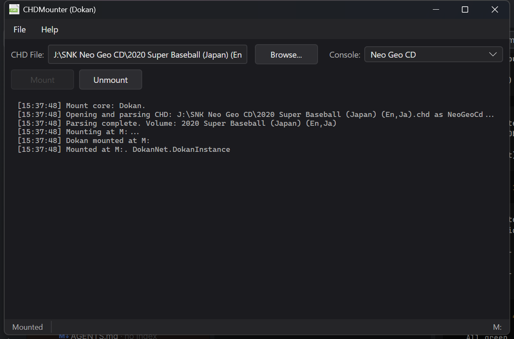

# Getting Started

This walkthrough mounts a CHD image with the GUI.

## 1. Install the prerequisites

Install the [.NET 10 runtime](https://dotnet.microsoft.com/download/dotnet/10.0) and the driver
for the mount core you will use: Dokan (default) or WinFsp on Windows, libfuse3 on Linux, or
macFUSE on macOS. See [Installation](installation.md).

## 2. Run CHDMounter

Extract the release bundle and run `CHDMounter` (`CHDMounter.exe` on Windows).

## 3. Select a CHD file

Click **Browse**, select a `.chd` file, and CHDMounter will suggest a filesystem type.

## 4. Pick the console/format type

Choose the matching entry from the dropdown, or type an alias such as `ps2` in the command line
when using the CLI. If you are not sure, start with `iso9660` or `psauto` for PlayStation discs.
See [Console Types](console-types.md) for the full list.

## 5. Mount

Click **Mount**. On success the drive letter (Windows) or mount folder (Linux/macOS) appears in
the status area and in your file manager. The volume is mounted **read-only**; your CHD file is
never modified.

If the mount fails because a driver is missing, CHDMounter shows a dialog with a link to the
driver download page — install the driver and try again.

## 6. Unmount

Click **Unmount** (or close the application) to remove the virtual drive. Closing the window while
an image is mounted unmounts it first.

## Tips

- Press **F8** to save a screenshot of the window (see [Screenshots](screenshots.md)).
- When a new version is available, CHDMounter offers to open the download page at startup (see
  [Usage](usage.md#update-checker)).
- Settings such as the mount core and auto-open behaviour live in **File → Settings**
  (see [Settings](settings.md)).

## Next steps

- Use the [command line](command-line.md) to mount from scripts or frontends.
- Learn how virtual CUE/BIN/ISO/WAV export works in [How It Works](how-it-works.md).
- Having trouble? See [Troubleshooting](troubleshooting.md).
